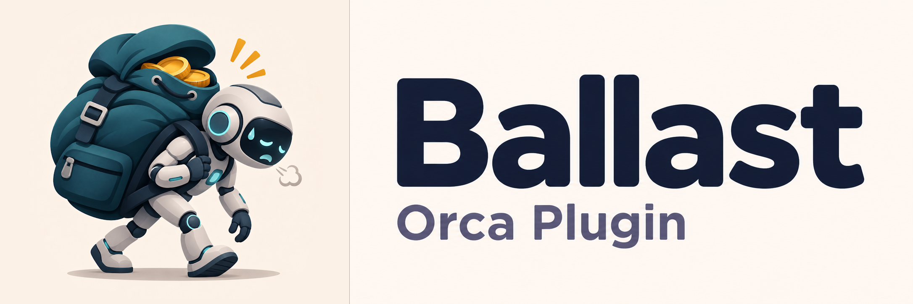

<p align="center">
  
</p>

<p align="center">
  <b>See what your coding agent carries into every session, and drop what this folder doesn't need.</b>
</p>

<p align="center">
  Version 0.7.0 · Orca ≥ 1.4.248 · Claude Code and Codex
</p>

---

Every plugin, skill, MCP server, claude.ai connector and memory file an agent loads costs context
before you type a word. A Figma server is worth it in a design repo, but it's dead weight in a
backend service. **Ballast** is an [Orca](https://github.com/stablyai/orca) panel that lists
everything the agent loads in the focused workspace, estimates what each item weighs in tokens, and
turns items on or off **for that folder only**, without touching your global configuration.

## Features

- **Follows the focused workspace.** There's no folder to type: the panel reads the workspace you're
  working in, as Explorer and Source Control do.
- **Everything in one place.** Plugins, skills, MCP servers, claude.ai connectors and memory
  (`CLAUDE.md`, `AGENTS.md`, auto-memory), each with its origin, its state and the setting level
  that decides that state.
- **Token estimates.** An estimated total for the folder, the heaviest items first, and a weight
  per item and per group ("Active: 18/20 · ~3.1k tokens").
- **Plugin skills together.** Expand a plugin to see its skills and their token weights. The Skills
  group lists standalone skills, and each group counts the items shown in its tabs.
- **Per-folder switches.** Enable, block or reset each item, or tick several and act on them at
  once. Changes are written straight away to the folder's own settings file, and **Undo**
  (undo) restores it byte for byte.
- **Minimal edits.** Only the keys Ballast needs change. Comments, key order, indentation and line
  endings stay as they were.
- **New-arrival alerts.** When a session picks up an MCP server or claude.ai connector this folder
  hasn't loaded before, you get a desktop notification and a "new" badge.
- **Status bar total.** The estimated context weight is always visible; click it to open the
  panel.

## Supported agents

**Claude Code and Codex only, for now.** Other agents aren't read.

| | Claude Code | Codex |
| :- | :- | :- |
| Plugins | `enabledPlugins` at every level, marketplaces, plugins synced from claude.ai | `[plugins."name@marketplace"]` in user and project `config.toml` |
| Skills | user, project and plugin skills | user, repo, system and plugin skills (`[[skills.config]]`) |
| MCP servers | user, local, `.mcp.json` and plugin servers, allow/deny rules | `[mcp_servers.*]` and plugin servers |
| claude.ai connectors | from the folder's recent session transcripts | — |
| Memory | managed, user and project `CLAUDE.md`, rules, `MEMORY.md` | global and project `AGENTS.md` chain |
| Writes to | `.claude/settings.json` (shared) or `.claude/settings.local.json` (personal) | `.codex/config.toml` |

Ballast never writes user-level or managed files, the user state file (`.claude.json`) or anything
inside `CODEX_HOME`. The full list of keys, levels and precedence rules is in
[How Ballast works](docs/how-it-works.md).

## Install

Ballast will be available in the Orca plugin directory. Alternatively, install it from a local
clone:

```sh
git clone https://github.com/MarcorOnline/ballast-orca-plugin.git
orca plugin install path/to/ballast-orca-plugin
```

Orca lists the access the plugin asks for (see [Permissions](#permissions)) and waits for your
approval. Then open **Ballast** from the right sidebar (gauge icon), or click the **Ballast** item
in the status bar.

## Using it

1. Open a workspace in Orca and start a Claude Code or Codex agent in it. Until an agent runs, the
   panel says "No agent in this workspace".
2. The panel shows the folder, the agent and the account it reads, then the estimated context and
   one group per kind of item.
3. Inside each group, **On** lists what is on and **Off** lists what is off. On each row,
   **Turn on here**, **Turn off here** and **Reset to default**
   act on that item. Or tick several rows and use the bulk button.
4. Changes apply from the agent's **next session** in that folder.

Under **Settings** you choose where Claude Code changes go: **Shared**
(`.claude/settings.json`, committed with the repo) or **Personal** (`.claude/settings.local.json`,
this machine only).

The panel follows Orca's language: English, or Italian when Orca (or the system) is set to Italian.
Every user-facing string lives in [`src/strings.ts`](src/strings.ts).

## Known limits

- **Claude | Codex switch.** When a workspace runs both agents, Ballast can't tell which tab has
  the focus: Orca's plugin API doesn't expose it and fires no event on a tab switch. A **Claude |
  Codex** switch picks the agent, and Ballast remembers the pick per workspace. The real fix
  depends on Orca: [stablyai/orca#38341](https://github.com/stablyai/orca/issues/38341).
- **Estimates, not counts.** Token weights are characters divided by four, over what the agent
  loads up front. Codex MCP servers show "unknown weight": nothing on disk says
  how many tools they expose.
- **Connectors appear after a session.** claude.ai connectors and late MCP servers aren't on disk.
  Ballast learns about them from the transcripts of a session that ran in the folder.
- **Not listed:** built-in tools, the system prompt, output styles and hooks.

The details, and the rules that are assumptions rather than documented behaviour, are in
[How Ballast works](docs/how-it-works.md#what-ballast-cannot-see-or-change).

## Privacy and safety

Agent configs hold tokens, environment values, headers and URLs with credentials. Ballast copies
out **names, booleans and structure only**. Secrets stay inside the worker and never reach the
panel, logs, notifications or plugin storage. Diffs mask every value outside the keys Ballast
writes. Credential files such as `auth.json` are never opened, and tool inputs and outputs are
never read. A test suite plants secrets in every source and checks that none of them leaks.

## Permissions

| Asked | Why |
| :- | :- |
| `trusted-worker` | read the agents' config folders, the project and its sessions; write the folder's settings file when you press a command |
| `workspace:read` | know the focused workspace and the path of each workspace |
| `agent:read` | know which agents run in the focused workspace |
| `storage:own` | remember terminal and agent links, launch profiles, and when each server was first seen |
| `notifications:show` | notify you when a new server or connector reaches a session |

Ballast also registers two hooks, `agent.launch.before` and `agent.tool.after`. Both only observe:
they pass the event on unchanged before doing any work.

## Development

Orca loads the plugin straight from `orca-plugin.json`; there is no build step.

```sh
npm install            # TypeScript and Node typings, for type checking only
npm run typecheck
orca plugin test .     # node:test against fixtures copied to a temp folder
orca plugin check .
orca plugin dev load . # load the working copy into Orca
```

| Path | What it is |
| :- | :- |
| `src/worker.ts` | the worker: wires the core to Orca events, hooks and requests |
| `src/core/` | scanning, workspace resolution, edits and undo, with no Orca dependency |
| `src/panel.tsx` | the panel UI (Orca components) |
| `src/model.ts`, `src/protocol.ts` | the data the worker sends and the requests it accepts |
| `src/strings.ts` | every user-facing string |
| `test/`, `fixtures/` | tests over fake Claude Code and Codex homes; they never touch a real config |

Bundled libraries: [jsonc-parser](https://github.com/microsoft/node-jsonc-parser) 3.3.1 (MIT) and
[smol-toml](https://github.com/squirrelchat/smol-toml) 1.3.1 (BSD-3-Clause, license file included)
in `src/vendor/`.

## License

Apache License 2.0. You may use, modify and redistribute Ballast, also commercially;
redistributions and forks must keep the copyright and NOTICE file crediting Marco Rinaldi as the
original author. See [LICENSE](LICENSE) and [NOTICE](NOTICE).
